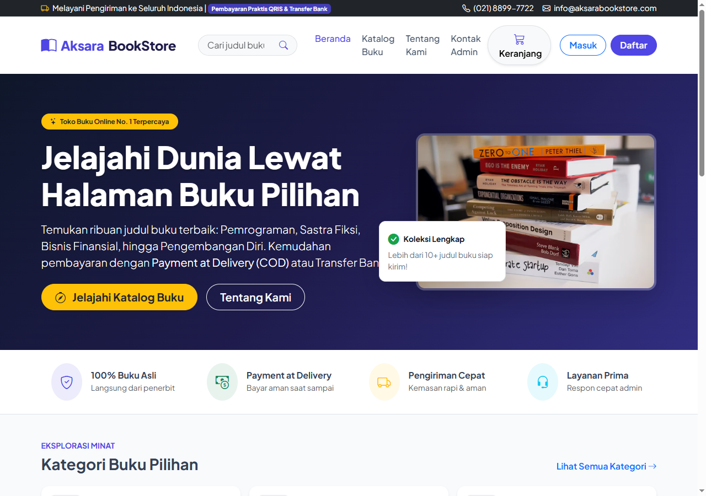
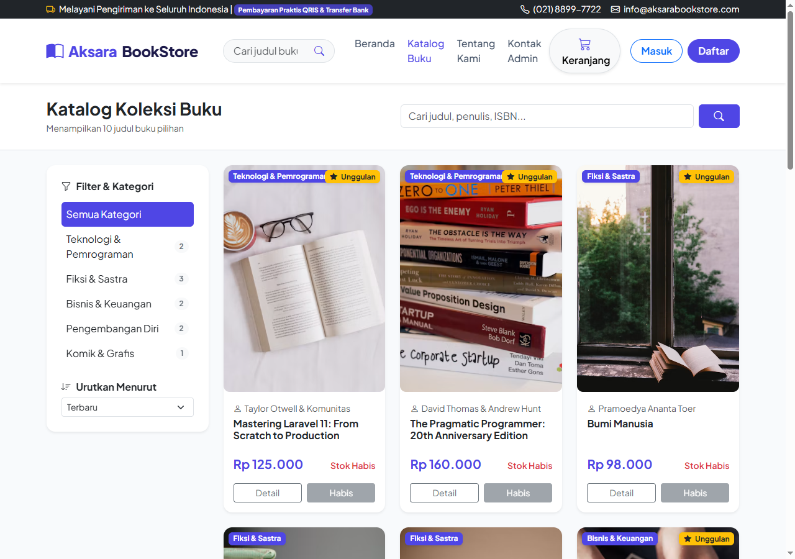
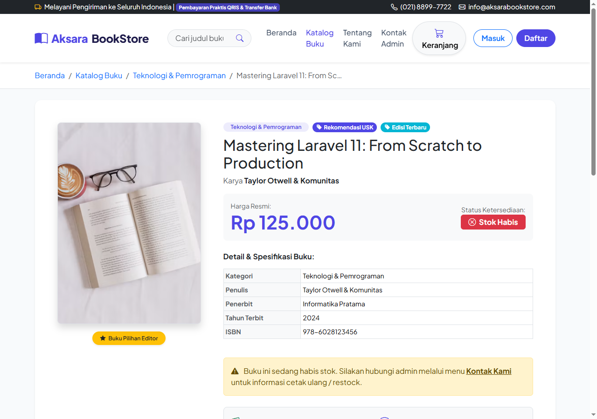
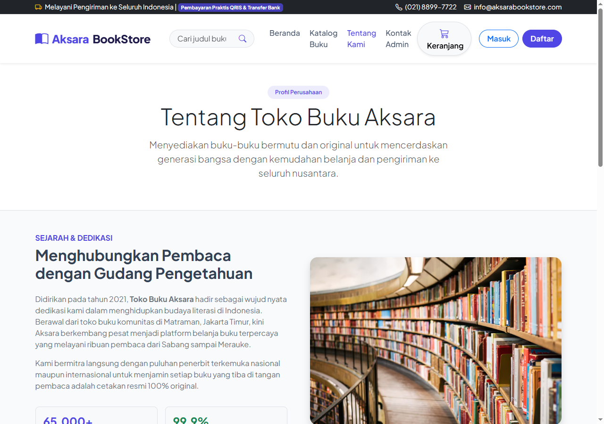
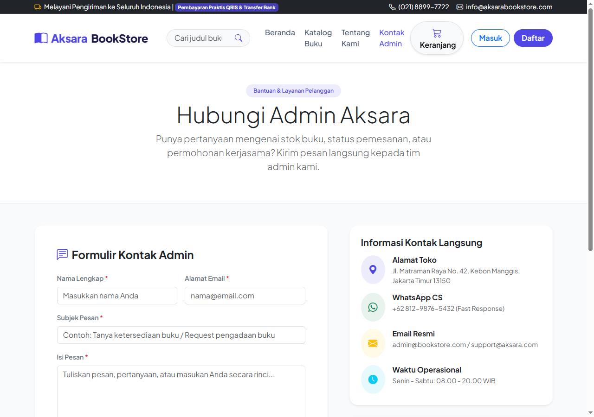
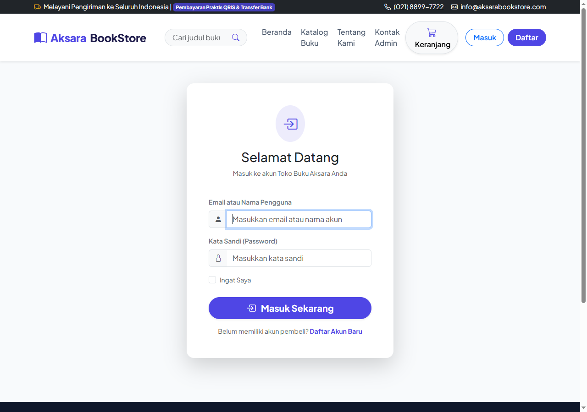
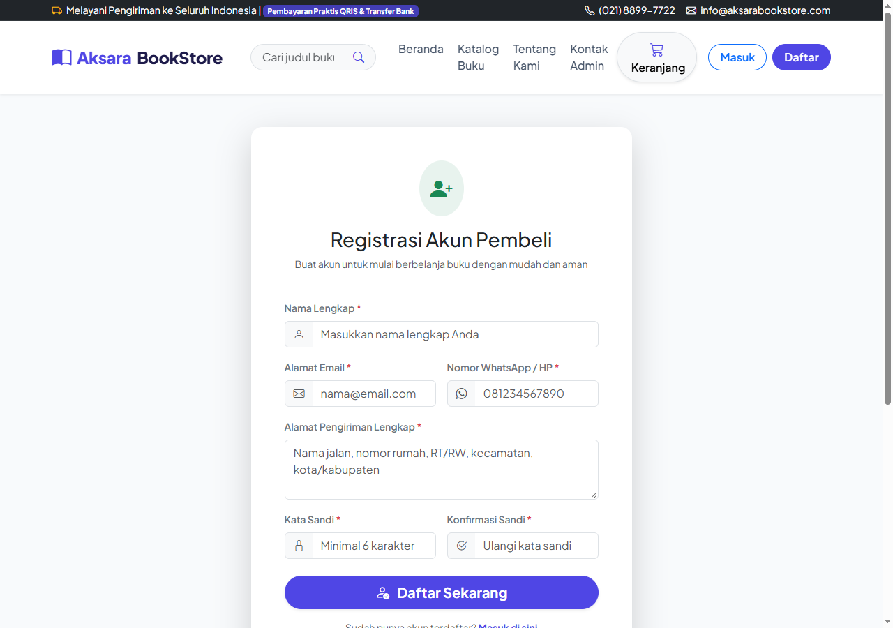
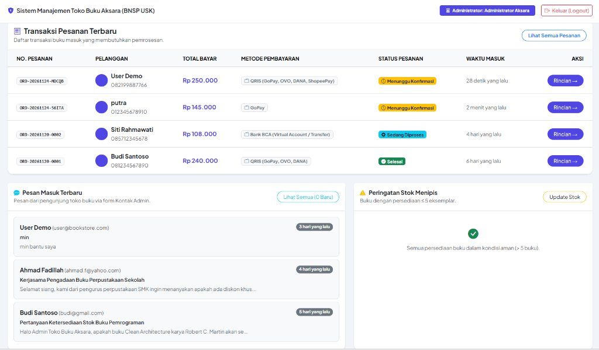
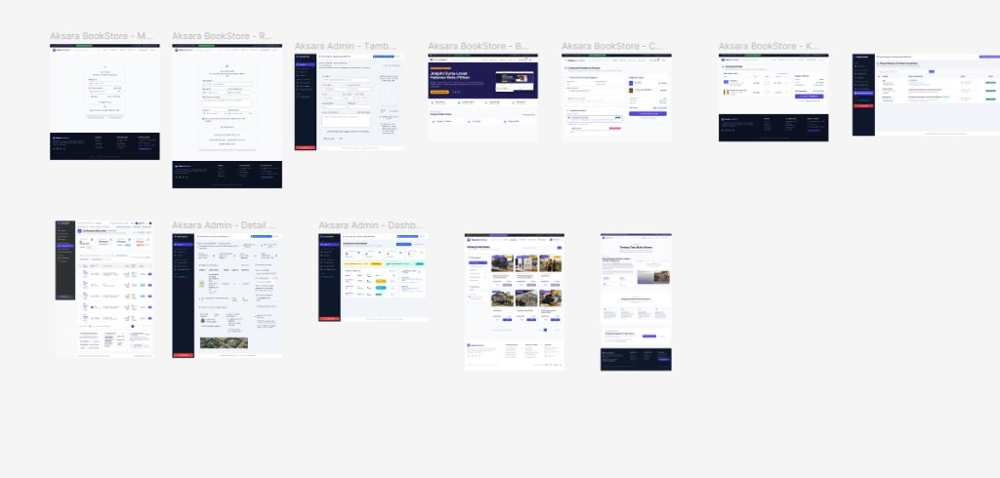
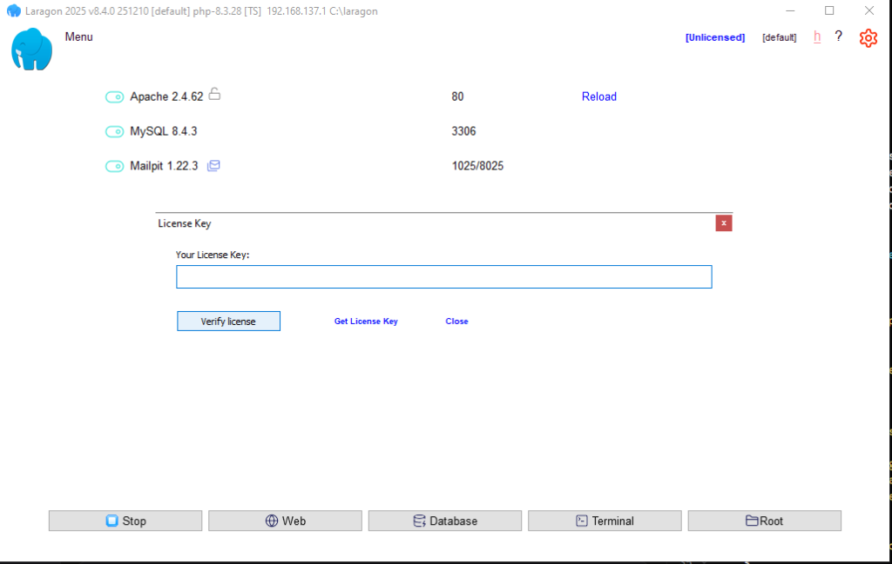

# Toko Buku Aksara (BookStore App)
**Aplikasi Toko Buku Online - Proyek Uji Sertifikasi Kompetensi (USK) BNSP Junior Web Developer**

Aplikasi web Toko Buku (*BookStore*) modern, responsif, dan lengkap yang dibangun menggunakan framework **Laravel 11**, **PHP 8.3**, **MySQL**, dan antarmuka **Bootstrap 5.3 + SweetAlert2**. Dirancang khusus untuk memenuhi 100% persyaratan dan unit kompetensi Uji Sertifikasi Kompetensi (USK) skema Junior Web Developer.

---

## 🎨 Desain UI/UX (Figma Prototype)
* **Tautan Desain Figma:** [Buka Desain UI/UX Aksara BookStore di Figma](https://www.figma.com/design/arUNIZqBLnnwwnmFADJxeq/MOBILE-PERPUS?node-id=0-1&p=f&t=DVKH2w6y84D9NSXA-0)
* Seluruh rancangan antarmuka (12 Halaman: Beranda, Katalog Buku, Detail Buku, Keranjang, Checkout, About Us, Kontak, Login, Register, Dashboard Admin, Kelola Buku, Kelola Pesanan) telah diimplementasikan secara presisi.

---

## 📸 Dokumentasi & Screenshot Antarmuka Web
Dokumentasi visual tangkapan layar antarmuka sistem tersimpan di folder [`screenshots/`](screenshots/):

| 1. Halaman Beranda (Home) | 2. Halaman Katalog Buku |
| :---: | :---: |
|  |  |

| 3. Halaman Detail Buku | 4. Halaman Tentang Kami (About Us) |
| :---: | :---: |
|  |  |

| 5. Halaman Kontak & Chat Admin | 6. Halaman Masuk (Login) |
| :---: | :---: |
|  |  |

| 7. Halaman Registrasi Akun | 8. Dashboard Administrator |
| :---: | :---: |
|  |  |

| 9. Desain UI/UX Figma Overview | 10. Lingkungan Server Laragon |
| :---: | :---: |
|  |  |

---

## 📌 Akun Pengujian (Demo Login)

Pada halaman Login (`/login`), tersedia tombol **1-Klik Isi Akun Demo** untuk mempermudah Asesor / Penguji:

| Aktor / Peran | Alamat Email | Kata Sandi (Password) | Hak Akses |
| :--- | :--- | :--- | :--- |
| **Administrator** | `admin@bookstore.com` | `admin123` | Akses penuh Panel Admin (`/admin`) |
| **User (Pelanggan)** | `user` | `user123` | Belanja, Keranjang, Checkout, Pesanan |
| **User Demo 2** | `budi@gmail.com` | `password123` | Akun pelanggan alternatif |

---

## 📋 Pemenuhan Persyaratan Soal USK BNSP

### 1. Fungsionalitas Aktor ADMIN
- [x] **Add/Update/Delete Kategori Buku**: Kelola kategori buku secara dinamis dengan nama, slug otomatis, deskripsi, serta pencegahan hapus kategori jika masih memiliki relasi buku.
- [x] **Add/Update/Delete Data Buku**: Kelola katalog buku lengkap (Judul, Kategori, Penulis, Penerbit, Tahun Terbit, ISBN, Harga, Stok, Deskripsi, Unggulan) disertai upload file gambar sampul (*cover image*) dengan live preview.
- [x] **List User yang Sudah Terdaftar**: Menampilkan seluruh pengguna terdaftar (nama, email, telepon, alamat lengkap, role, jumlah order, tanggal bergabung) dan opsi manajemen akun.
- [x] **List Pesanan Buku dari User Berbeda**: Menampilkan seluruh transaksi belanja dari berbagai pengguna, melihat detail item yang dibeli, dan memperbarui status pesanan (*Pending, Processing, Shipped, Completed, Cancelled*) serta status pembayaran (*Unpaid, Paid*).
- [x] **Fitur Tambahan Admin**: Dashboard statistik transaksi & omset, peringatan stok menipis (&le; 5 buku), serta inbox pesan masuk dari fitur *Contact to Admin*.

### 2. Fungsionalitas Aktor USER (Pelanggan)
- [x] **Registrasi User**: Formulir pendaftaran akun pembeli lengkap dengan validasi data (Nama, Email unik, No. HP/WhatsApp, Alamat Pengiriman, Password confirmed).
- [x] **Login & Logout User**: Autentikasi aman berbasis enkripsi bcrypt dengan session management dan redirect berbasis role.
- [x] **Melihat Detail Halaman About Us**: Informasi lengkap tentang Toko Buku Aksara, visi & misi, jaminan keaslian buku, jam operasional, dan lokasi toko fisik.
- [x] **Contact to Admin**: Formulir pengiriman pesan/pertanyaan yang terhubung langsung ke database dan dapat dibaca oleh Admin di panel pengelola.
- [x] **Pencarian Buku**: Pencarian real-time berdasarkan judul, penulis, penerbit, atau ISBN, dilengkapi filter per kategori dan pengurutan (*sorting*) harga / rilisan terbaru.
- [x] **Add to Cart Buku**: Memasukkan buku ke keranjang belanja dengan validasi stok, update jumlah eksemplar, hapus item, dan perhitungan subtotal otomatis.
- [x] **Payment at Delivery & Checkout**: Checkout pesanan dengan formulir data penerima, alamat pengiriman, dan sistem **Payment at Delivery (Pembayaran Buku Sebelum Buku Dikirim)** via QRIS, E-Wallet (GoPay, DANA, OVO, ShopeePay), maupun Transfer Bank (BCA, Mandiri, BRI), otomatis mengurangi stok buku dan mengosongkan keranjang belanja.
- [x] **Riwayat Pesanan & Invoice**: Daftar riwayat belanja user dan tampilan struk/invoice pesanan resmi yang siap dicetak (*Print Ready*).

---

## 🛠️ Pemenuhan Standar Unit Kompetensi (SKKNI / BNSP)
1. **J.620100.005.02 (Mengimplementasikan User Interface)**:
   - Tampilan responsif (Desktop, Tablet, Mobile) dengan Bootstrap 5.3, tipografi Plus Jakarta Sans, card hover effect, badge status, dan dialog interaktif SweetAlert2.
2. **J.620100.010.02 (Menerapkan Eksekusi Bahasa Pemrograman Teks, Grafik, dan Multimedia)**:
   - Fitur upload gambar sampul buku (JPG, JPEG, PNG, WEBP), validasi ukuran file & MIME type, preview gambar saat upload, dan fallback cover SVG bila gambar tidak tersedia.
3. **J.620100.015.01 (Menyusun Sumber Daya Pemrograman dalam Organisasi yang Rapi)**:
   - Pola arsitektur MVC (Model-View-Controller) Laravel yang bersih, modular, dan terstruktur.
4. **J.620100.016.01 (Menulis Kode Sesuai Guidelines dan Best Practices)**:
   - Enkripsi password bcrypt, perlindungan CSRF Token di seluruh form POST/PUT/DELETE, sanitasi input, Eloquent ORM untuk mencegah SQL Injection, dan Route Middleware Authorization (`auth`, `admin`).
5. **J.620100.017.02 (Mengimplementasikan Pemrograman Terstruktur)**:
   - Relasi database SQL yang kuat (`users`, `categories`, `books`, `carts`, `orders`, `order_items`, `contacts`), integritas foreign key, serta database transaction (`DB::transaction`) saat proses checkout pesanan.
6. **J.620100.019.02 (Menggunakan Library Pre-Existing)**:
   - Bootstrap 5.3, Bootstrap Icons, SweetAlert2.

---

## 🚀 Cara Menjalankan Aplikasi di Laragon

1. Buka browser dan akses salah satu URL berikut:
   - Melalui Apache Laragon: **`http://localhost/bookstore/public`**
   - Atau jalankan `php artisan serve` di terminal, lalu buka: **`http://127.0.0.1:8000`**

2. Jika ingin menjalankan ulang migrasi dan data awal (seeder):
   ```bash
   php artisan migrate:fresh --seed
   ```

3. Menjalankan pengujian otomatis (Unit/Feature Test):
   ```bash
   php artisan test
   ```
